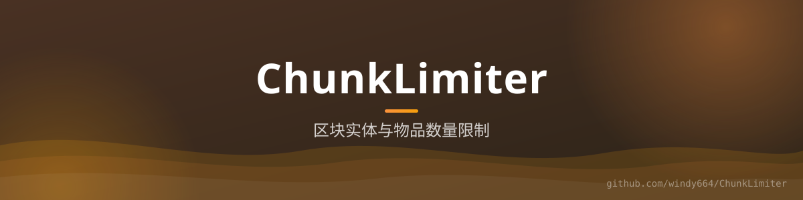

<div align="center">



# ChunkLimiter

**区块数量限制** —— 监控区块内的实体/方块数量，超出上限自动拦截，防刷屏防卡服。


[功能](#-功能) · [配置](#️-配置) · [构建](#-构建)

</div>

## ✨ 功能

- **区块限额**：`ChunkLimiterListener` 在放置/生成时统计所在区块的计数，超过配置上限直接取消
- **可配置上限**：限额项与数值全部走 `Config`，按服务器规模自行调整
- **低开销**：只在实际变更事件上计数，不做全服扫描

## ⚙️ 配置

`config.yml` 中按类型配置各区块上限（方块/实体等），超出即拦截并提示。

## 🔨 构建

```bash
./gradlew build
```

## 📄 许可

[MIT](LICENSE)
